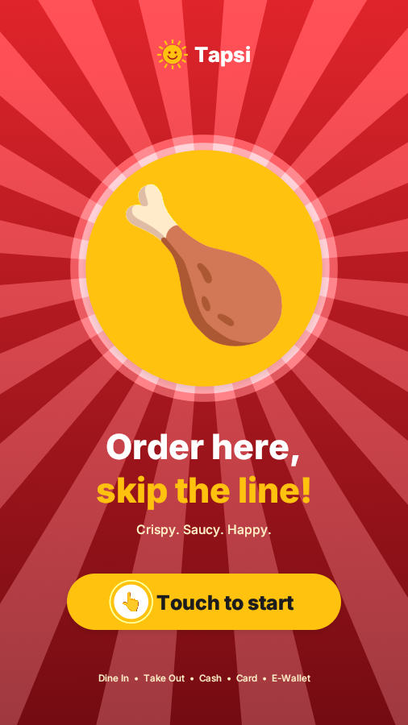
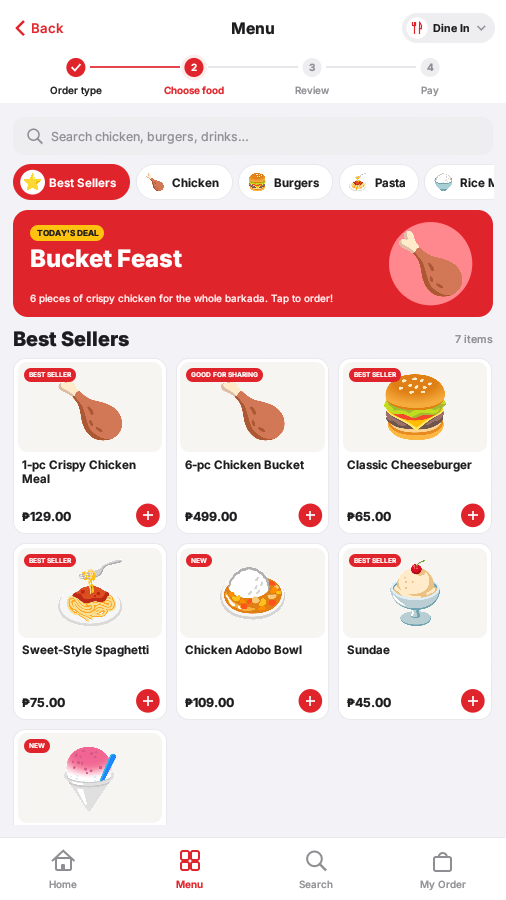
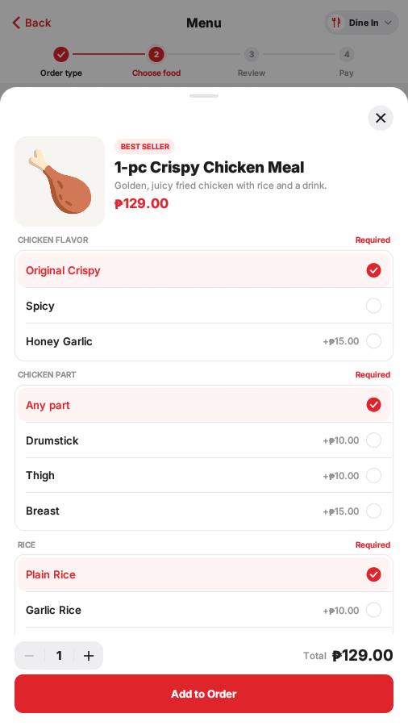
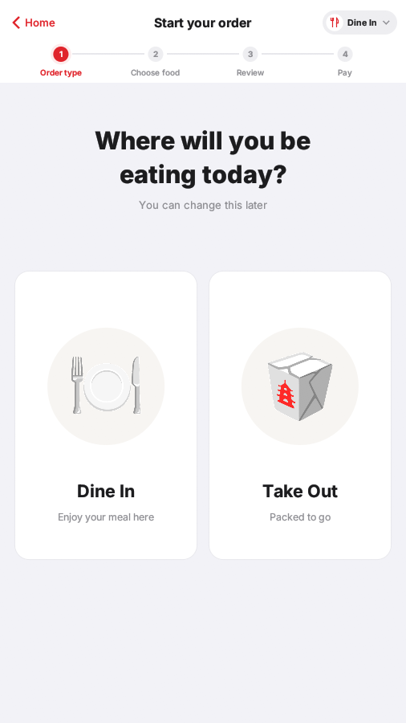
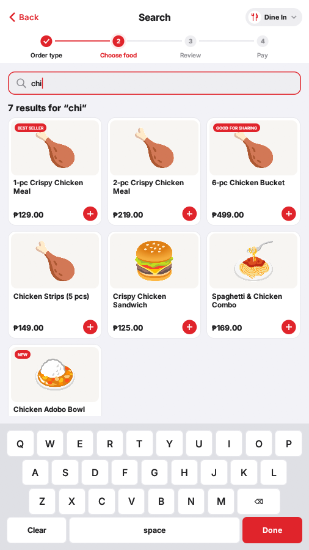
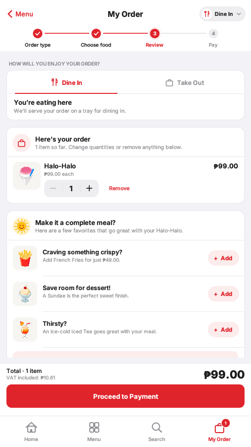
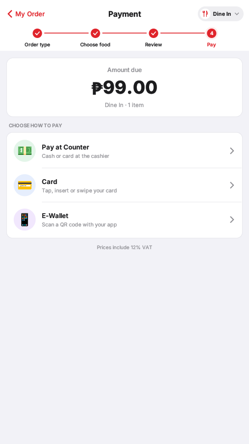
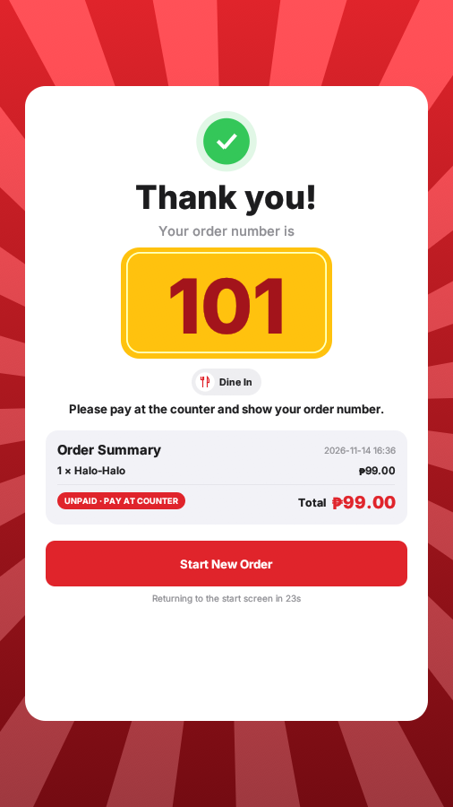

# Tapsi

**A fast, friendly self-ordering kiosk for quick-service restaurants.**

Customers walk up, browse the menu, make their order exactly how they like it, and pay - without
waiting in line. Tapsi is built with Rust, so it starts instantly and runs smoothly even on modest
hardware.

<p align="center">
  
  
  
</p>

## What it does

- **Easy ordering for everyone** - big, friendly buttons and clear pictures, made for touch screens.
- **Always know where you are** - guided steps, a back button and a home button on every page.
- **Make it your way** - choose flavors, sides, drinks and add-ons for each item.
- **Find anything fast** - search the whole menu with the on-screen keyboard.
- **Helpful suggestions** - a gentle "make it a complete meal?" prompt, only when the customer asks.
- **Dine in or take out** - customers pick once and can change their mind any time.
- **Flexible payment** - pay at the counter, by card or by e-wallet.
- **Order numbers** - every order gets a number to call when the food is ready.
- **Resets itself** - returns to the welcome screen when a customer walks away.

## Fast and lightweight

Tapsi is a native app written in Rust - no web browser, no internet connection and no server
needed. Measured on an everyday laptop:

| | |
| --- | --- |
| App size | about 6 MB, a single file |
| Start-up | window open in under 0.1 seconds |
| Memory | about 110-125 MB, steady while ordering |
| CPU while waiting on the menu | under 1% of one core |
| CPU on the animated welcome screen | about 7% of one core |

## Screenshots

| Welcome | Dine in or take out | Menu | Customize |
| :---: | :---: | :---: | :---: |
|  |  |  |  |

| Search | My order | Payment | Order number |
| :---: | :---: | :---: | :---: |
|  |  |  |  |

## Try it

1. Install [Rust](https://www.rust-lang.org/tools/install).
2. Download this project and open a terminal in its folder.
3. Run:

   ```sh
   cargo run --release
   ```

Tapsi opens in a window on your computer. On a real kiosk screen, start it in full-screen mode:

```sh
cargo run --release -- --kiosk
```

## Make it yours

The menu - store name, categories, items, prices, pictures and options - lives in a single file,
`assets/menu.json`. Edit it to match your restaurant; no programming needed.

## Good to know

Tapsi is a working demo. Card and e-wallet payments are simulated, so connect a real payment
terminal before using it with customers.

## License

Copyright 2026 Adam. Released under the [Apache License 2.0](LICENSE).

Tapsi also includes the [Inter](https://rsms.me/inter/) font (SIL Open Font License) and food
pictures from [Noto Emoji](https://github.com/googlefonts/noto-emoji) (Apache License 2.0).
